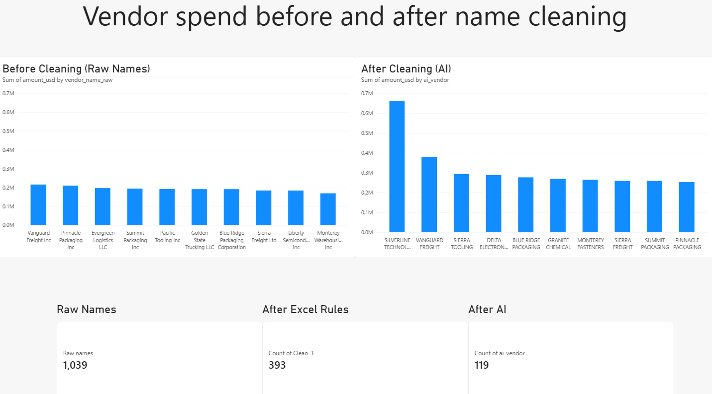
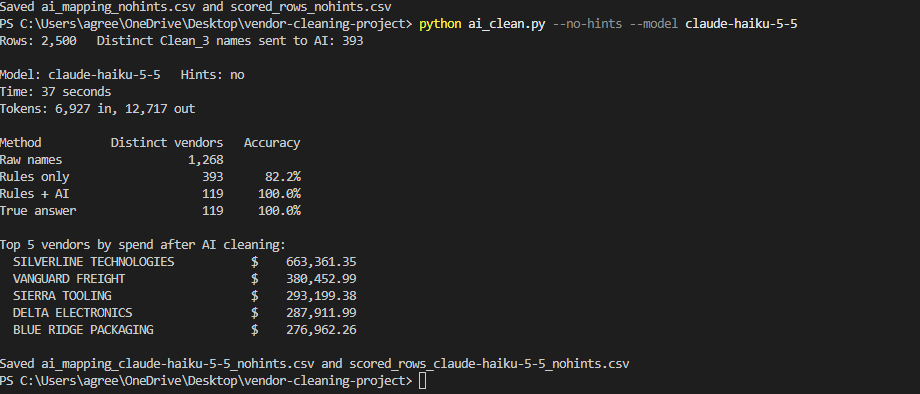

# Vendor Name Cleaning: Excel Rules vs. an LLM

Purchasing systems collect the same supplier under many spellings: "Silverline Technologies Ltd", "SILVERLINE TECH", "silverline techhnologies ltd". When spend is reported by vendor name, each spelling becomes its own row, and the biggest suppliers look smaller than they are.

This project cleans 2,500 purchase orders two ways, first with rule-based formulas in Excel and then with a large language model (Claude) through its API, and scores both against an answer key.



## Results

| Method | Distinct vendor names | Purchase orders assigned to the right vendor |
|---|---|---|
| Raw data | 1,268 | n/a |
| Excel rules | 393 | 82.2% |
| Excel rules + Claude Sonnet 5.5 | 119 | 100.0% |
| Excel rules + Claude Sonnet 5.5, no abbreviation hints | 119 | 100.0% |
| Excel rules + Claude Haiku 5.5, no abbreviation hints | 119 | 100.0% |
| True answer | 119 | 100.0% |

- **The ranking changed.** In the raw data the top vendor appears to be Vanguard Freight Inc at $215,920. After cleaning, the true top vendor is Silverline Technologies at $663,361, whose spend had been split across dozens of spellings.
- **The AI closed the gap rules couldn't.** Rules fixed case, spacing, punctuation and legal suffixes, but not typos ("BAYVIE WFASTENERS") or abbreviations ("BAYVIEW MFG"). The LLM fixed all of them.
- **The smallest model was enough.** Haiku matched Sonnet's accuracy and ran faster (37 s vs. 43 s), so it would be the cost-effective choice for this task.
- **Cost:** all API runs together cost about **$X**. Each run sent about 7,000 input tokens and received about 9,000 to 13,000 output tokens.



## Method

**1. Explore (Excel).** A pivot table on the raw names showed 1,038 distinct values. Python counts 1,268, because Excel pivot tables ignore upper and lower case.

**2. Rule-based cleaning (Excel).** Three helper columns:

```
Clean_1  =UPPER(TRIM(C2))
Clean_2  =SUBSTITUTE(SUBSTITUTE(F2,".",""),",","")
Clean_3  =REGEXREPLACE(REGEXREPLACE(G2,"^THE |\s*(- CA|- AP|\(REMIT\)|#2)$",""),
                       "\s(INC|INCORPORATED|LLC|CORP|CORPORATION|CO|COMPANY|LTD|LIMITED)$","")
```

Scored with XLOOKUP against the answer key: 82% of purchase orders matched.

**3. LLM cleaning (Python, Claude API).** `ai_clean.py` sends the 393 distinct `Clean_3` names to Claude in one request and asks it to group spellings of the same company and return a standard name for each as JSON. Only the distinct names are sent, not all 2,500 rows, which keeps the request small and cheap.

**4. Scoring.** The AI may choose a different standard name than the answer key ("SILVERLINE TECHNOLOGIES" vs. "Silverline Technologies Ltd"), so the script scores *grouping*, not exact text. Each true vendor is matched to the group holding most of its purchase orders; rows split into other groups, or merged into another vendor's group, count as wrong. Rules and AI are scored the same way.

**5. Robustness checks.** The first prompt listed common abbreviations (MFG = MANUFACTURING, and so on). Because I knew how the data was made messy, that could have given the model an unfair advantage, so I reran without the hints and with a smaller model. Accuracy held at 100% in every run, and a repeat of the main run gave the same result.

**6. Dashboard (Power BI).** Top-10 vendor spend before and after cleaning on a shared axis, plus distinct-name counts at each stage.

## Limitations

- **The data is synthetic.** I generated it so every purchase order has a known correct vendor, which real data doesn't provide. Real vendor files also have harder cases this dataset doesn't, such as renamed companies, subsidiaries and parent companies.
- **Every AI run scored 100%,** so this dataset isn't hard enough to separate the models. A harder test set would be the next step.
- **The model can be wrong without warning.** In production I would review its groupings, at least for high-spend vendors, before using them in reporting.

## What went wrong along the way

The first API run crashed: the model returned a "thinking" block before its answer, and my code assumed the first block was the answer. The fix was to keep only text blocks from the response. I also switched to streaming so long replies don't time out.

## Files

| File | What it is |
|---|---|
| `purchase_orders_messy_v2.csv` | The messy input data |
| `answer_key_v2.csv` | True vendor for every purchase order |
| `purchase_orders_messy_v2.xlsx` | Excel work: pivots, cleaning formulas, scoring |
| `ai_clean.py` | Sends names to Claude, scores both methods, saves results |
| `ai_mapping*.csv` | The AI's name-to-vendor mapping for each run |
| `scored_rows*.csv` | Every purchase order with rules and AI results |
| `vendor_cleaning.pbix` | Power BI dashboard |
| `generate_data.py` | Recreates the dataset exactly (seed 4) |

## Run it yourself

```
pip install -r requirements.txt
set your ANTHROPIC_API_KEY environment variable
python ai_clean.py                                  # main run
python ai_clean.py --no-hints                       # without abbreviation hints
python ai_clean.py --no-hints --model claude-haiku-5-5
```

Tools: Excel (pivot tables, XLOOKUP, REGEXREPLACE), Python (pandas), Claude API, Power BI.
